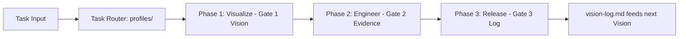

# V.E.R.

> See it. Build it. Ship it. Every release feeds the next vision.

V.E.R. (**V**isualize → **E**ngineer → **R**elease) is an always-on agent rule system delivered as a single file, [`AGENTS.md`](AGENTS.md), at the root of a repository. It eliminates vibe-coding hallucinations by enforcing hard gates, Karpathy principles, and the Ponytail ladder. A gate is evidence, not narration: an agent cannot proceed because it claims work is complete, but only when it demonstrates proof.

---

## Quickstart

Install the full rule set into your repository:

```bash
npx @papabear911/ver --project
```

Three installation targets are available:

| Target | Command | Result |
|---|---|---|
| **Project** | `npx @papabear911/ver --project [dir]` | Places `AGENTS.md` and rule directories (`profiles/`, `phases/`, `refine/`, `references/`) |
| **User-global** | `npx @papabear911/ver --global` | Installs to `~/.claude/ver/` with an `@ver/AGENTS.md` import |
| **Agent config** | `npx @papabear911/ver --agent <name>` | Updates configuration for `claude`, `cursor`, or `gemini` |

### The Golden Rule: Append, Never Replace

VER is safe to install in existing codebases. It never overwrites, truncates, or destroys existing agent configurations (`AGENTS.md`, `CLAUDE.md`, `.cursorrules`, etc.). It appends an idempotent marked block or imports cleanly.

For full multi-agent instructions and manual installation options, see [`INSTALL.md`](INSTALL.md).

---

## Why Hard Gates

LLMs fail by sounding confident while fabricating code:

| Model Failure | Where VER Catches It |
|---|---|
| **Fabricated APIs** | **Engineer: Establish** forces reading the codebase before writing code. |
| **Inaccurate parameters** | **Engineer: Execution** demands running code; running code is the only truth. |
| **Non-existent libraries** | **Visualize: Validate** requires checking existing dependencies first. |
| **False test results** | **Engineer: Execution** requires actual test execution output, not claims. |
| **Invented work & loops** | **Gate-Failure Protocol** halts after two consecutive failed gates. |

---

## The V.E.R. Loop

Development proceeds through three sequential phases, each sealed by a non-negotiable **Hard Gate**:

```
Visualize ──▶ Engineer ──▶ Release ──▶ (feeds next Vision)
```



### 1. Phase 1 — VISUALIZE (See it)
- **Visualize:** Restate the task as an observable outcome. Define what "done" looks like.
- **Validate:** Read codebase patterns and dependencies. Apply the Ponytail ladder (stop at the first rung that holds; YAGNI first).
- **Vision:** Present the smallest plan with explicit tradeoffs. Ask clarifying questions.
- **HARD GATE 1 (Vision Approved):** Explicit approval (`yes`, `go`, `approved`, `ship it`) is required. Silence or vague responses halt progression.

### 2. Phase 2 — ENGINEER (Build it)
- **Establish:** Read the actual files to touch. Verify imports, types, and function signatures exist in the codebase.
- **Engineering:** Implement the minimum code satisfying the approved vision. Keep changes surgical. Annotate deliberate simplifications with a ceiling and upgrade path (see [`references/ponytail-ladder.md`](references/ponytail-ladder.md)).
- **Execution:** Run the code, tests, or scripts. Evidence must be shown in the session, not asserted.
- **HARD GATE 2 (Evidence Shown):** Verified running output. Hypotheses without execution fail the gate.

### 3. Phase 3 — RELEASE (Ship it)
- **Refinement:** Inspect the diff top to bottom. Prune unneeded code and comments.
- **Rollout:** Re-verify tests, check public surface for unintended drift, and run layered security checks.
- **Release:** State what shipped, what was skipped, include a mandatory rollback line (`To undo: [command]`), and record exactly one learning in [`vision-log.md`](vision-log.md).
- **HARD GATE 3 (Shipped and Logged):** Verification green, security clear, rollback documented, and learning logged.

---

## Task Routing & Profiles

Before Phase 1 starts, a 15-line router reads the task description, detects domain keywords, and loads only the relevant profiles from [`profiles/`](profiles/):

| Domain | Profile | Trigger Keywords |
|---|---|---|
| programming | [`profiles/programming.md`](profiles/programming.md) | function, class, refactor, bug, API, logic, module |
| security | [`profiles/security.md`](profiles/security.md) | auth, secret, token, input, deletion, admin, permission, session |
| ui | [`profiles/ui.md`](profiles/ui.md) | component, render, layout, style, button, form, modal |
| ux | [`profiles/ux.md`](profiles/ux.md) | flow, state, empty, loading, error, copy, undo, first-use |
| data | [`profiles/data.md`](profiles/data.md) | query, schema, migration, pipeline, dataset, model, experiment |
| devops | [`profiles/devops.md`](profiles/devops.md) | deploy, infra, config, terraform, container, CI, pipeline |
| testing | [`profiles/testing.md`](profiles/testing.md) | test, spec, coverage, mock, fixture |
| docs | [`profiles/docs.md`](profiles/docs.md) | readme, doc, comment, changelog, tutorial |

- **Manual Override:** Prefix tasks with `@domain` or `@domain+domain` (e.g. `@security+ux add password reset flow`).
- **Stacking Rule:** Profiles stack. When gates conflict or overlap, **the stricter gate wins**.
- **Default:** Unmatched tasks run the base loop. Pure questions are answered directly without entering the loop.

---

## Developer Guide & Operations

### Layered Security
Every release runs through three defensive tiers:
1. **Automated:** Static scan of the diff for OWASP patterns, hardcoded secrets, and injection.
2. **Guard:** Evaluates logic, permissions, and data flow whenever sensitive surfaces (auth, secrets, admin, deletion) are touched.
3. **Human Escalation:** Triggers when confidence is low or changes are irreversible.
See [`references/security-gates.md`](references/security-gates.md).

### The Refine Passes
Optional standalone passes to inspect or polish changes at any stage:

| Pass | Profile | Trigger | Hard Gate |
|---|---|---|---|
| **Validate** | [`refine/validate.md`](refine/validate.md) | "validate", "does this match vision?" | No silent drift or gaps accepted |
| **Enhance** | [`refine/enhance.md`](refine/enhance.md) | "tighten it", "simplify", "delete unneeded" | Diff is minimal coherent change |
| **Review** | [`refine/review.md`](refine/review.md) | "review the diff", "ready to ship?" | Verdict must be Ship before release |

### Repository Verification
Run the installer test suite:

```bash
npm test
```

Tests run via Node.js built-in test runner against [`test/ver.test.js`](test/ver.test.js:1).

---

## References

- [`AGENTS.md`](AGENTS.md) — The core constitution and loop definitions.
- [`INSTALL.md`](INSTALL.md) — Detailed agent-specific setup and troubleshooting.
- [`INVARIANTS.md`](INVARIANTS.md) — Project non-negotiables and governance rules.
- [`BOOTSTRAP.md`](BOOTSTRAP.md) — Prompt snippet for session initialization.
- [`references/karpathy-principles.md`](references/karpathy-principles.md) — First-principles engineering heuristics.
- [`references/ponytail-ladder.md`](references/ponytail-ladder.md) — Seven-rung simplicity ladder and simplification guidelines.

---

## License

MIT. See [`LICENSE`](LICENSE).

**Author:** Ver Sangil.
