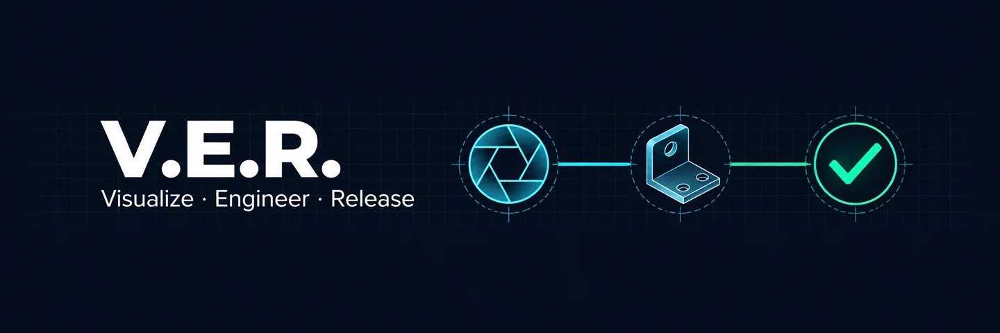
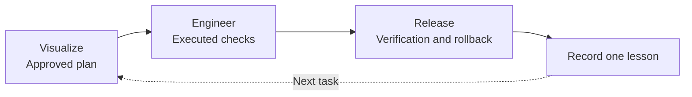

# V.E.R.



[](https://nodejs.org/)
[](#technology-stack)
[](https://github.com/PapaBear911/VER/actions/workflows/ci.yml?query=branch%3Amain)
[](https://github.com/PapaBear911/VER/blob/main/LICENSE)

**Visualize → Engineer → Release** is a workflow for coding agents. It asks the agent to agree on an observable outcome, show evidence from executing the work, and document how to undo the release.

> See it. Build it. Ship it. Every release feeds the next vision.

[Quickstart](#quickstart) · [Copyable prompts](#copyable-prompts) · [Workflow](#workflow) · [Technology stack](#technology-stack) · [Installation guide](https://github.com/PapaBear911/VER/blob/main/INSTALL.md)

## Quickstart

**Requires Node.js 18 or later.** Run these commands from the root of the project you want to configure. The first clones the tagged source into a sibling directory; keep that checkout for the maintenance commands below.

```sh
git clone --depth 1 --branch v2.2.2 https://github.com/PapaBear911/VER.git ../ver-source
node ../ver-source/bin/ver.js --project .
node ../ver-source/bin/ver.js --check .
```

The installer adds a VER pointer to your root `AGENTS.md` and places the full rules, profiles, and manifest in `.ver-rules/`. Open a fresh agent session so it loads the updated instructions. The audit should end with `All configured static checks passed.`

The CLI's installed name is `ver-rules`, which avoids the built-in Windows `ver` command. `node ../ver-source/bin/ver.js` is the same entry point, run straight from the checkout.

### Install for a specific agent

Pick the command for your agent and run it from the project root. These commands install the project rules and add the agent-specific import or rule.

| Agent | Command | Configuration |
| --- | --- | --- |
| Codex and other agents that load `AGENTS.md` | `node ../ver-source/bin/ver.js --project .` | `AGENTS.md` |
| Claude Code | `node ../ver-source/bin/ver.js --agent claude` | `CLAUDE.md` |
| Cursor | `node ../ver-source/bin/ver.js --agent cursor` | `.cursor/rules/ver.mdc` |
| Gemini CLI | `node ../ver-source/bin/ver.js --agent gemini` | `GEMINI.md` |

### Update, uninstall, or install a Git hook

| Task | Command |
| --- | --- |
| Update project rules | `node ../ver-source/bin/ver.js --update` |
| Uninstall project rules | `node ../ver-source/bin/ver.js --uninstall` |
| Add the static audit to a Git pre-commit hook | `node ../ver-source/bin/ver.js --hook` |

On update, VER refreshes files whose hashes still match the install manifest. It keeps local modifications and preserves conflicting destinations during legacy migration. Uninstall uses that same ownership record to remove or restore unchanged files. Run the quickstart audit again after an update.

### Install for your Claude Code user account

Run this from PowerShell or a POSIX shell. VER installs to your home directory and adds an import to your user-level Claude configuration.

```sh
node ../ver-source/bin/ver.js --global
node ../ver-source/bin/ver.js --check "$HOME/.ver-rules"
```

For later maintenance, use `--update --global` or `--uninstall --global` with the same checkout command.

### Refresh the checkout

To move to a newer tag, fetch it into the existing checkout and run the installer again from your project root.

```sh
git -C ../ver-source fetch --depth 1 origin tag v2.2.2
git -C ../ver-source checkout v2.2.2
node ../ver-source/bin/ver.js --update
```

## Copyable prompts

Paste these into your agent chat. Replace bracketed text where needed.

### Install and verify VER

```text
Install VER in the current project from GitHub:
git clone --depth 1 --branch v2.2.2 https://github.com/PapaBear911/VER.git ../ver-source
node ../ver-source/bin/ver.js --project .
node ../ver-source/bin/ver.js --check .
Report the audit result and the agent configuration files changed.
```

### Plan a feature

```text
@ver Add [feature]. Read the relevant source and tests. Define the observable outcome, show the smallest plan, and list the exact checks that will prove it works. Wait for my approval before changing files.
```

### Fix a bug with a regression check

```text
@programming+testing Fix [bug]. Reproduce [observed failure], identify its cause, and show a regression check that fails on the current code. After approval, make the smallest fix and run the same check again.
```

### Review a sensitive change

```text
Review the current diff for authorization, input validation, and unintended writes. Give findings with file paths, reproduction steps, and expected behavior. Include the highest-impact missing test. Keep the review read-only.
```

### Verify and prepare a release

```text
@devops+testing Prepare the current change for release. Report the exact commit, executed checks, public behavior changes, and rollback command. Identify any remaining blocker before publication. Record one lesson in vision-log.md.
```

## Workflow



| Phase | Evidence needed to proceed |
| --- | --- |
| **Visualize** | Agree on a checkable outcome, the smallest implementation, and how to verify it. |
| **Engineer** | Read the relevant source, implement the approved plan, and show output from the relevant checks. |
| **Release** | Review what will ship, verify the public behavior, document rollback, and record one lesson in `vision-log.md`. |

The task router selects domain profiles such as security, UX, docs, and testing. Use `@security+ux` to combine profiles. Pure questions can be answered directly. The static audit checks rule files and markers. Session approval, test execution, and rollout each need their own evidence. [Core rules](https://github.com/PapaBear911/VER/blob/main/AGENTS.md) · [Domain profiles](https://github.com/PapaBear911/VER/tree/main/profiles)

## Technology stack

| Layer | Technology | Role |
| --- | --- | --- |
| ⬢ **Runtime** | Node.js 18+ · JavaScript | One-shot CLI with zero third-party runtime dependencies |
| ▣ **Distribution** | Git · GitHub Releases | Tagged source and the `ver-rules` installer CLI |
| ◇ **Rules** | Markdown · `AGENTS.md` | Portable instructions, profiles, and gate definitions |
| ◎ **Ownership** | JSON · SHA-256 | Tracks installed files and distinguishes local edits |
| ✓ **Verification** | `node:test` · GitHub Actions | Installer tests and audits on Windows and Linux across Node 18, 20, and 22 |

## Examples and project docs

- [Engineering walkthrough](https://github.com/PapaBear911/VER/blob/main/examples/walkthrough.md) · [Policy pilot](https://github.com/PapaBear911/VER/blob/main/examples/policy-walkthrough.md) · [Research study](https://github.com/PapaBear911/VER/blob/main/examples/research-walkthrough.md) · [Physical commissioning](https://github.com/PapaBear911/VER/blob/main/examples/commissioning-walkthrough.md)
- [Installation and troubleshooting](https://github.com/PapaBear911/VER/blob/main/INSTALL.md) · [Bootstrap prompt](https://github.com/PapaBear911/VER/blob/main/BOOTSTRAP.md) · [Refinement passes](https://github.com/PapaBear911/VER/tree/main/refine)
- [Changelog](https://github.com/PapaBear911/VER/blob/main/CHANGELOG.md) · [Releases](https://github.com/PapaBear911/VER/releases) · [Issues](https://github.com/PapaBear911/VER/issues)

## License

[MIT](https://github.com/PapaBear911/VER/blob/main/LICENSE) © Ver Sangil.
